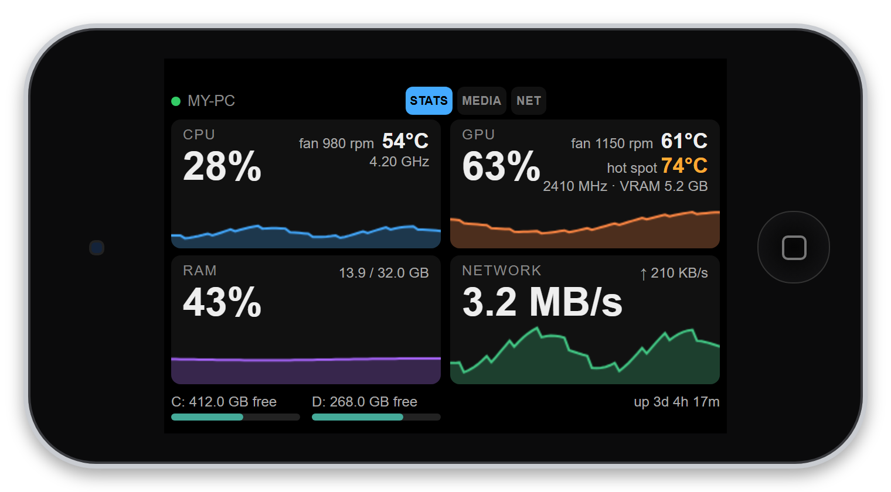

# iPodStats

An old iPod touch 3G (iOS 5.1.1) reused as a second screen for a Windows PC. The PC runs a small web server and the iPod shows its page over Wi-Fi.


*Mockup of the stats page with made-up sample data.*

## What it does

- PC stats: CPU, GPU, memory, disk, network, temperatures and fan speeds
- Current song with cover art, playback and volume controls
- Network tab: speed, ping to the router and the iPod, devices on the network
- Game tab with FPS, which appears while a fullscreen game runs (AMD GPUs)
- AI tab with speed numbers from a local KoboldCpp model (ports and names are listed in `server.cpp`)
- Custom wallpapers, and control of the iPod page with the PC mouse

## How to run

Needs Windows and MinGW g++.

1. Build:
   ```
   g++ -std=c++17 -O2 -Wall server.cpp -o iPodStats.exe -lws2_32 -liphlpapi -lole32
   ```
2. Create `allowed.txt` next to the program, with the iPod's MAC address on its own line.
3. Run `start.bat` (visible window) or `run-hidden.vbs` (background). `stop.bat` stops it.
4. On the iPod, open `http://<PC address>:8099` in Safari and add it to the home screen.

A blocked device and its MAC address are listed at `http://localhost:8099/debug`.

Optional:

- [LibreHardwareMonitor](https://github.com/LibreHardwareMonitor/LibreHardwareMonitor) with its web server on port 8085, for CPU temperature and fan speed.
- Pictures in a `backgrounds` folder, to use as wallpapers.

## Tech

- C++17 server with no third-party libraries
- One HTML page in ES5, written for iOS 5 Safari
- PowerShell helpers that read song info through Windows APIs
- AMD ADL for GPU readings

## What I built

- A web server that reads Windows and GPU sensors and sends them to the page
- A page that stays light enough for a 256 MB device, updating only what changed
- A live mouse cursor on the iPod using the old WebSocket version its Safari supports
- Only this PC and approved devices (listed by MAC address) can open the page
